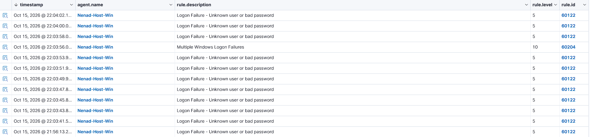
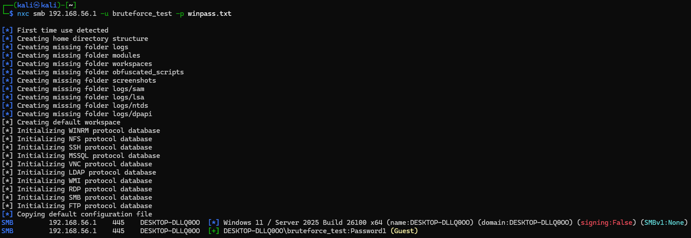
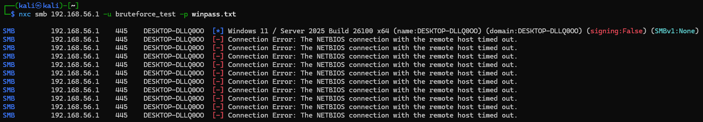
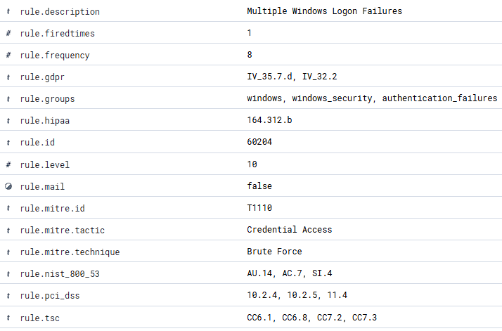
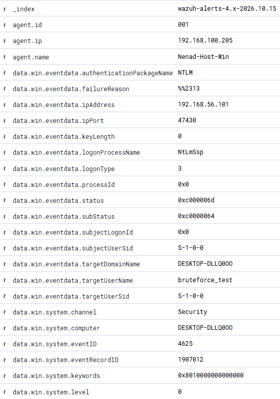

# Windows Logon Monitoring with Wazuh

**Scenario 03 — Credential Access / Windows Brute Force**

Detecting and triaging an SMB brute-force attack against a monitored Windows host,
end to end: run the attack from Kali, watch Wazuh decode the failed logons and
correlate them into a single high-severity alert, and triage it as an L1 analyst.
The twist is that the brute-force test surfaced a real misconfiguration before it
even produced a single failure — which turned into the most useful finding here.

---

## 1. Objective

Exercise the full detection path for a Windows credential-access attack: generate
failed logons against a real monitored endpoint, see how Wazuh turns raw Windows
Security events (4625) into a correlated brute-force alert, and work the alert the
way a SOC analyst would. Along the way, learn the Windows logon telemetry well
enough to read a 4625 without a cheat sheet.

**Why it matters:** most SOC environments are Windows-heavy, and failed-logon
noise is a daily reality. Knowing which 4625 fields actually matter — and when a
pile of them becomes an incident — is core L1/L2 work (MITRE ATT&CK T1110).

---

## 2. Environment

| Role | Host | IP | Notes |
|------|------|----|----|
| Wazuh server (manager + indexer + dashboard) | `Ubuntu-implementacija` | `192.168.100.145` | Agent 001's manager |
| Monitored endpoint | `DESKTOP-DLLQ0OO` ("Nenad-Host-Win") | `192.168.100.205` / host-only `192.168.56.1` | Wazuh agent `001`, Windows 11 |
| Attacker | Kali Linux VM | `192.168.56.101` | Source of the attack |

**Wazuh version:** 4.14.x
**Log source on target:** Windows Security event channel, decoded by
`windows_eventchannel`.

> **Topology note:** the host sits on two networks at once. The attack comes in
> over the VirtualBox host-only network (`192.168.56.0/24`), so the source IP in
> the logon events is the Kali VM's real address, `192.168.56.101`. The agent then
> reports to the Wazuh manager over the separate `192.168.100.0/24` network. Two
> paths, one host — worth keeping straight when reading the alerts.

---

## 3. The telemetry — reading a Windows failed logon

Windows writes a **Security event 4625** ("An account failed to log on") for every
failed authentication. The Wazuh agent ships the Security channel to the manager,
where the `windows_eventchannel` decoder flattens each event into
`data.win.system.*` and `data.win.eventdata.*` fields.

The fields that actually drive triage on a 4625:

| Field (Wazuh) | Meaning | Value in this attack |
|---------------|---------|----------------------|
| `data.win.system.eventID` | Event type | `4625` (failed logon) |
| `data.win.eventdata.targetUserName` | Account that was tried | `bruteforce_test` |
| `data.win.eventdata.ipAddress` | Source of the attempt | `192.168.56.101` |
| `data.win.eventdata.logonType` | How they tried to log on | `3` (network) |
| `data.win.eventdata.subStatus` | Precise failure reason | `0xC0000064` |

Two of these decode the "why" and "from where", which is most of triage:

- **`logonType 3`** = a network logon (SMB here), as opposed to `2` (interactive
  at the keyboard) or `10` (RDP). It tells you the attack came over the wire.
- **`subStatus 0xC0000064`** = "user name does not exist". The other one to know is
  `0xC000006A` = "user exists, bad password". The distinction matters: a flood of
  `0xC0000064` is someone guessing *usernames*; `0xC000006A` against one real
  account is someone guessing its *password*.



---

## 4. The detection logic — from single failures to one alert

Wazuh handles this with a two-level rule chain, same idea as the SSH scenario:

- Every 4625 matches **rule 60122 — "Logon Failure - Unknown user or bad
  password"** (level 5). On its own, one of these is noise; failed logons happen
  all day.
- When enough of those stack up from the same source in a short window, **rule
  60204 — "Multiple Windows Logon Failures"** (level 10) fires once — its threshold
  is 8 failures inside the window (`rule.frequency: 8`). That's the alert an analyst
  actually wants to see — it's the difference between "a failed
  logon" and "someone is hammering this box".

Level 5 → level 10 is the whole point of correlation: suppress the per-event
noise, raise one meaningful signal when a pattern emerges.

---

## 5. Executing the attack

From Kali, a short password list against a **non-existent** user, so every attempt
is guaranteed to fail and no real account can be compromised or locked out:

```bash
printf 'Password1\nWelcome1\nadmin\nP@ssw0rd\nletmein\nSummer2026\nCompany123\nspring\nmonkey\ndragon\n' > winpass.txt
nxc smb 192.168.56.1 -u bruteforce_test -p winpass.txt
```

(`nxc` = netexec, the current SMB brute-force workhorse on Kali.)

### The detour that became the finding

The first run didn't fail at all — it *succeeded*:

```
SMB  192.168.56.1  445  DESKTOP-DLLQ0OO  [+] DESKTOP-DLLQ0OO\bruteforce_test:Password1 (Guest)
```

That `(Guest)` is the tell. The host had the built-in **Guest account enabled**, and
SMB was happily mapping any unknown username onto it. So a bogus credential didn't
produce a failed logon (4625) — it produced a *successful* Guest logon (4624), and
netexec stopped on the first "valid" result. The brute force couldn't even get off
the ground, because authentication never actually failed.



That's a real weakness, not just a test nuisance: with Guest reachable over SMB,
anyone on the network gets a foothold with no valid credentials at all. More on
this in Section 6.

I disabled the Guest account (hardening, and it unblocks the test):

```powershell
Disable-LocalUser -Name Guest
```

### The real run

With Guest gone, the same command behaved like an actual brute force — every
attempt rejected:

```
SMB  192.168.56.1  445  DESKTOP-DLLQ0OO  [-] bruteforce_test:Password1  (and so on, x10)
```

netexec actually reported each attempt as a "NETBIOS connection timed out", which
looked like a failure to reach the host. It wasn't — the host was just slow to
answer the authentication, and the attempts landed anyway. Confirmed at the source
with 12 fresh 4625 events, all from `192.168.56.101`, `logonType 3`, `subStatus
0xC0000064`, inside about a 20-second window. (Lesson in miniature: the attacker
tool's output isn't ground truth — verify at the target.)



---

## 6. Key Finding — the brute-force test exposed an enabled Guest account

> This is the most useful result of the scenario.

Before the attack could generate a single failure, it revealed that **the Guest
account was enabled and reachable over SMB**. Any unknown username authenticated
successfully as Guest. In detection terms that's doubly bad:

1. **It's a standing foothold.** An attacker needs no valid credentials — "log in
   as anyone" quietly becomes "log in as Guest". That maps to MITRE **T1078.001
   (Valid Accounts: Default Accounts)**.
2. **It hides the brute force.** Guest fallback turns what should be a loud stream
   of 4625 failures into quiet 4624 *successes*, so the very behaviour your
   correlation rule is watching for never gets logged. The misconfiguration
   defeats the detection as a side effect.

This ties straight back to triage (Section 7): the standard analyst reflex after a
brute force is "did anything succeed from this source?" Run that check here and it
pays off — the same IP, `192.168.56.101`, had a **successful Guest logon** minutes
earlier, during the first run. If this were real, that's no longer a failed brute
force to close as benign; it's a source that already got in.

The fix (disabling Guest) hardened the host and made the brute-force detection work
as intended. A test that finds a real problem before it even does what you planned
is a good test.

---

## 7. Triage — alert 60204

Working the level-10 "Multiple Windows Logon Failures" alert:

| Question | Answer (from the alerts) |
|----------|--------------------------|
| **What happened?** | Windows brute force, rule 60204, level 10 |
| **Source?** | `192.168.56.101` (Kali VM — authorised lab activity) |
| **Target?** | `DESKTOP-DLLQ0OO` (agent 001), account `bruteforce_test` (does not exist) |
| **When / how much?** | 12 failures in ~20 s, same IP, `logonType 3` — automated pattern |
| **Did anything succeed from this source?** | **Yes** — a Guest logon (4624) from the same IP during the earlier run. In a real incident this escalates the ticket. |
| **Technique?** | MITRE T1110 — Brute Force; the Guest access is T1078.001 |

### Triage conclusion (ticket-ready)

> **Alert:** Windows brute force (rule 60204, level 10) — MITRE T1110.
> **Source:** 192.168.56.101 (Kali VM, authorised lab test).
> **Target:** DESKTOP-DLLQ0OO (agent 001), account "bruteforce_test" (non-existent).
> **Detail:** 12 failed network logons (4625 / subStatus 0xC0000064) in ~20 s from
> a single source — clear automated pattern.
> **Related:** the same source had a successful Guest logon (4624) before Guest was
> disabled, i.e. the host had an enabled Guest account exposed over SMB.
> **Assessment:** True positive by detection, benign in context (authorised test,
> target account does not exist). The Guest exposure it uncovered is the real issue
> and has been remediated.
> **Recommendation:** Keep Guest disabled, block insecure guest auth, and in
> production block the source IP (Active Response).





---

## 8. MITRE ATT&CK Mapping

| Tactic | Technique | ID |
|--------|-----------|----|
| Credential Access | Brute Force | T1110 |
| Credential Access | Brute Force: Password Guessing | T1110.001 |
| Persistence / Defense Evasion / Initial Access | Valid Accounts: Default Accounts (the enabled Guest account) | T1078.001 |

---

## 9. Remediation / Production Recommendations

- **Keep the Guest account disabled** — it was the root issue here. Nothing on a
  modern host should depend on it.
- **Block insecure guest auth on clients** (`Lanman Workstation` policy) so a
  machine won't silently fall back to guest access against a server either.
- **Enforce an account lockout policy** so password-guessing against *real*
  accounts stops itself (Windows 11 ships a default, but confirm it's set).
- **Harden SMB** — require signing, and don't expose 445 to untrusted network
  segments. SMB should be internal-only.
- **Wire rule 60204 into Active Response** to auto-block the source IP, the same
  way the Suricata rules drive `firewall-drop` elsewhere in this lab.
- **Monitor for success-after-failure** — the highest-value correlation: a burst
  of 4625s followed by a 4624 from the same source. This scenario is a live example
  of exactly why that matters.

---

## 10. Skills Demonstrated

- Reading Windows Security telemetry in Wazuh (`data.win.*`, `windows_eventchannel`)
- Knowing the 4625 fields that matter: `logonType`, `subStatus` (0xC0000064 vs 0xC000006A)
- Windows failed-logon correlation (rule 60122 → rule 60204)
- Running a realistic SMB brute force from Kali (netexec) without lockout risk
- Spotting a real misconfiguration (enabled Guest over SMB) during offensive testing
- Verifying at the source when tool output is ambiguous (the "NETBIOS timeout" that wasn't)
- Alert triage and ticket-ready documentation, including the success-after-failure check
- MITRE ATT&CK mapping (T1110, T1078.001)
