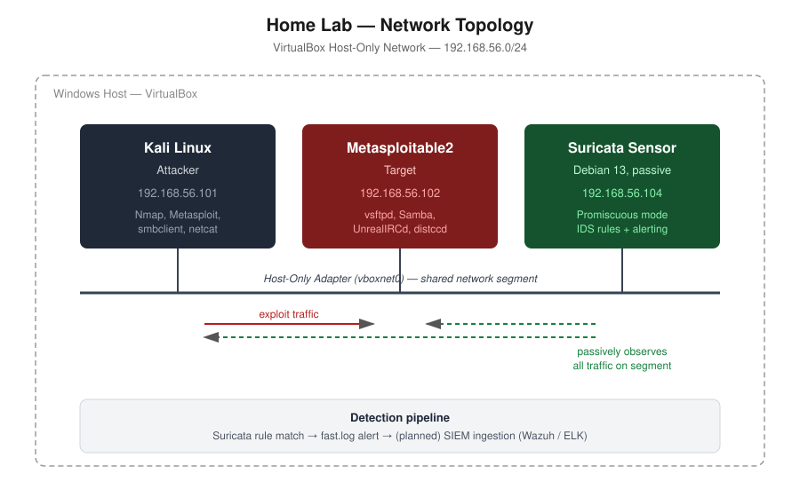

# SOC Analyst Home Lab Portfolio

Hands-on work exploiting, detecting, and analyzing security vulnerabilities in a
controlled lab (Kali Linux + Metasploitable2 on VirtualBox). Each writeup covers
the whole thing end to end: enumeration, exploitation (by hand and/or with
Metasploit), detection from the blue-team side, and remediation, with MITRE
ATT&CK mapping throughout.

## How it all fits together

This isn't a pile of separate exercises. Each piece builds on the last, and
together they walk through a full security operations cycle.

I started by building the **monitoring infrastructure**: a complete Wazuh SIEM
stack, installed by hand, package by package, instead of the automated script.
Doing it that way surfaced every dependency the automated install hides — TLS
certificates, Filebeat as its own log shipper, the exact config file names each
component expects. The real troubleshooting that came with it (DNS hijacking,
disk issues, systemd timeouts) is written up as part of the process, not swept
under the rug.

Next I wrote **custom Suricata IDS rules** for each exploit and integrated them
with Wazuh through a custom decoder/rules approach (not a ready-made module), with
MITRE ATT&CK mapping showing up in the Threat Hunting dashboard. Every rule was
tested against real exploit traffic from the Kali VM to the Metasploitable2
target.

Then I closed the loop with **Active Response**: when Suricata catches an exploit
attempt and Wazuh raises the alert, the system blocks the attacker's IP at the
firewall automatically, and unblocks it after a set timeout.

So the full chain runs end to end: I launch an attack from Kali, Suricata catches
it on the network, Wazuh raises an alert with a MITRE tag, and the system responds
on its own.

## Topology

## Infrastructure & SIEM Setup

Manual install of the Wazuh SIEM stack (indexer, manager, dashboard) on Ubuntu
Server, including TLS certificates, Filebeat integration, and troubleshooting of
real problems (DNS, disk, services):
[infrastructure/wazuh-siem-setup/README.md](infrastructure/wazuh-siem-setup/README.md)

Suricata IDS integrated with Wazuh via a custom decoder/rules approach, with MITRE
ATT&CK mapping visible in the Threat Hunting dashboard:
[infrastructure/wazuh-siem-setup/suricata-decoder-integration.md](infrastructure/wazuh-siem-setup/suricata-decoder-integration.md)

Wazuh Active Response — automatic iptables block of the attacker's IP when a
custom Suricata rule fires, with auto-unblock after a timeout:
[infrastructure/wazuh-siem-setup/active-response.md](infrastructure/wazuh-siem-setup/active-response.md)

## Writeups

| # | Name | CVE | Method | MITRE ATT&CK |
|---|-------|-----|-------|---------------|
| 00 | [Recon](writeups/00-recon) | — | Nmap full scan | T1046, T1590 |
| 01 | [vsftpd 2.3.4 Backdoor](writeups/01-vsftpd-backdoor) | CVE-2011-2523 | Manual + Metasploit | T1190, T1059 |
| 02 | [Samba usermap_script RCE](writeups/02-samba-usermap) | CVE-2007-2447 | Manual + Metasploit | T1190, T1059, T1021.002 |
| 03 | [UnrealIRCd Backdoor](writeups/03-unrealircd-backdoor) | CVE-2010-2075 | Manual + Metasploit | T1190, T1059 |
| 04 | [distcc RCE](writeups/04-distccd-rce) | CVE-2004-2687 | Metasploit | T1190, T1059 |

## Detection Engineering

Suricata IDS rules tested against each exploit in the table above, including
tracking down and fixing a false positive:
[detection-engineering/](detection-engineering)

## Tools used in the lab
- Kali Linux (attacker)
- Metasploitable2 (target)
- Nmap, Metasploit Framework, smbclient, netcat
- Suricata IDS (custom rules, MITRE ATT&CK mapping)
- Wazuh SIEM (indexer, manager, dashboard, Filebeat)
- VirtualBox (host-only network `192.168.56.0/24`)

## About me

I'm moving from data engineering into cybersecurity, aiming at SOC Analyst (L1/L2)
roles. My background is in physical chemistry and spectroscopy (University of
Belgrade), and I currently work as a Data Integration Engineer at ZF Group. This
lab is where I work through attacks from both sides, offensive and defensive, to
prepare for a SOC role. I hold CompTIA Security+.
