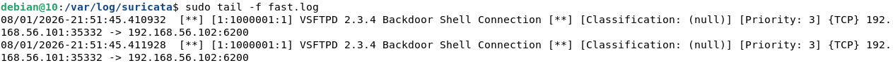
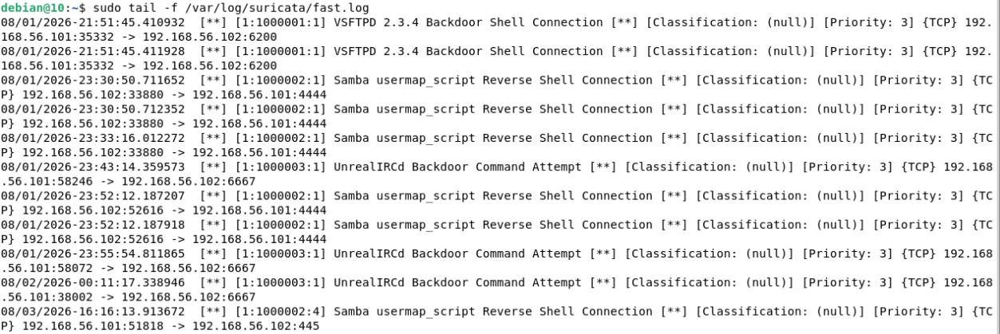
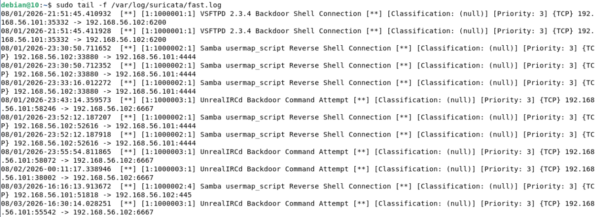
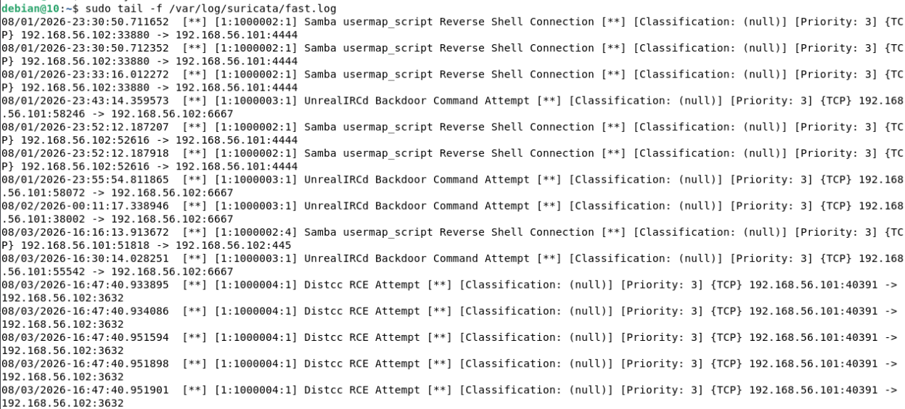

# Detection Engineering

This part flips the portfolio from offense to defense. Instead of "how do I break
in", the question becomes "how do I notice someone broke in". For each exploit in
`writeups/` I wrote a Suricata rule, and I actually tested every one of them
against the real attack rather than just writing a signature that looks right on
paper.

## Setup

Suricata runs on its own VM (`suricata-sensor`, Debian 13), separate from Kali and
Metasploitable, on the same VirtualBox host-only network (`192.168.56.x`). I
wanted the sensor to be a passive observer sitting between attacker and target,
the same way a real network would have a sensor that doesn't take part in the
traffic, just listens to it.

Two adapters on the sensor VM:
- **NAT** — internet access only (for apt), not used for monitoring
- **Host-only** — where Suricata listens, with **Promiscuous Mode: Allow All** on.
  Without that, the VM only sees traffic meant for itself, not anyone else's.

I installed Suricata from `apt`, pointed it at the host-only interface (`enp0s8`),
and put my rules in a separate file (`/var/lib/suricata/rules/custom.rules`)
loaded alongside the default set.

## Rules

| Exploit | SID | Port(s) | Detection type |
|---|---|---|---|
| vsftpd 2.3.4 backdoor | 1000001 | 6200 | flow-based |
| Samba usermap_script | 1000002 (rev 4) | 139, 445 | hex content match |
| UnrealIRCd backdoor | 1000003 | 6667 | content match |
| distccd RCE | 1000004 | 3632 | flow-based |

Full rules file: [`rules/custom.rules`](rules/custom.rules)

---

### vsftpd 2.3.4 backdoor

alert tcp any any -> any 6200 (msg:"VSFTPD 2.3.4 Backdoor Shell Connection"; flow:established; sid:1000001; rev:1;)

Port 6200 only opens once the backdoor fires, so just seeing a connection to it is
a reliable enough signal. No need to dig into the packet contents.

---

### Samba usermap_script — a false positive, and how I fixed it

This rule took three tries to get right, and all three are worth walking through
because this is where I learned the most.

**First version** only looked at port 4444, the port the Samba payload sends its
reverse shell to:

alert tcp any any -> any 4444 (msg:"Samba usermap_script Reverse Shell Connection"; flow:established; sid:1000002; rev:1;)

It worked — until I ran the UnrealIRCd exploit, which also throws a reverse shell
to 4444. The rule fired and reported a Samba attack when it was actually
UnrealIRCd. The problem was that it only cared about the port, not about anything
that makes the Samba attack the Samba attack, so every reverse shell on 4444
looked the same regardless of where it came from.

**Second version** tried to fix that by watching port 139 (SMB) and looking for
the word `nohup` (part of the payload) in the content:

alert tcp any any -> any 139 (msg:"Samba usermap_script Command Injection Attempt"; content:"nohup"; sid:1000002; rev:2;)

This caught nothing. `tcpdump` showed me two reasons why:
1. Modern `smbclient` defaults to port **445**, not 139.
2. SMB encodes username/path fields in **UTF-16LE**, so every character has a null
   byte after it (`n\x00o\x00h\x00u\x00p\x00`). A plain ASCII search for `nohup`
   was never going to find that.

**Third and final version** covers both ports and matches the exact byte sequence
in UTF-16LE (hex notation):

alert tcp any any -> any [139,445] (msg:"Samba usermap_script Command Injection Attempt"; content:"|6E 00 6F 00 68 00 75 00 70 00|"; sid:1000002; rev:4;)

Tested and confirmed. It catches the Samba attack correctly and stops firing by
mistake when I run the UnrealIRCd exploit alongside it.

**Takeaway:** port-based rules are quick to write but trip over false positives
the moment two different attacks happen to share an outbound port. Content
matching is more dependable, but only if you first check how the protocol actually
puts the data on the wire. Assuming it was plain ASCII is exactly what burned me
here.

---

### UnrealIRCd backdoor

alert tcp any any -> any 6667 (msg:"UnrealIRCd Backdoor Command Attempt"; content:"AB"; sid:1000003; rev:1;)

Looks for the trigger string `AB` (which the backdoor reads as the start of a
command) on the IRC port. My first version had `;` in the content (`"AB;"`), but
that `;` inside the `content` quotes got read as the end of a rule option, so
parsing broke. I had to drop it.

---

### distccd RCE

alert tcp any any -> any 3632 (msg:"Distcc RCE Attempt"; flow:established; sid:1000004; rev:1;)

Same idea as vsftpd. Port 3632 is specific to distcc, so watching for an
established flow on it is enough without any content match.

---

## What's next

- Add a SIEM layer (Wazuh or ELK) to centralize these alerts into a dashboard
  instead of reading them out of `fast.log`.
- Test the rules against legitimate traffic (a normal SMB file transfer, say) to
  confirm they don't false-positive the other way too.
- Add rules for the rest of the exploits as I document them.
