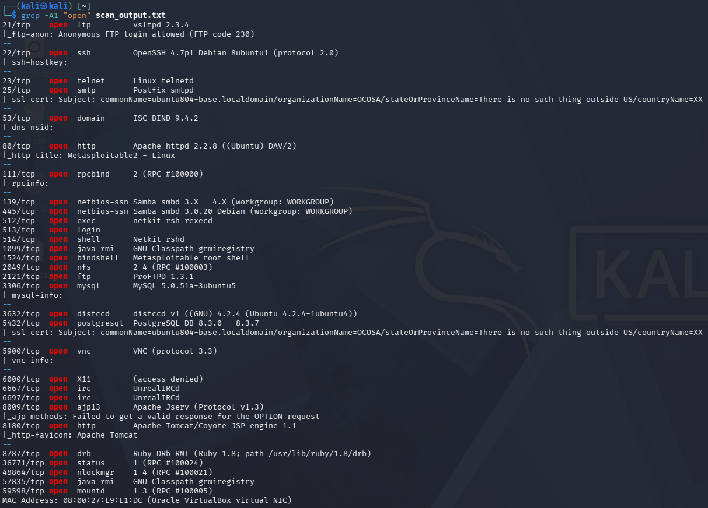

# Recon — Metasploitable2

The first phase of the engagement: enumerate the target to find open ports,
running services, and their versions. Whatever this phase turns up decides what I
go after first, and in what order, in the writeups that follow.

## Target
- IP: 192.168.56.102
- Date: 2026-07-13
- Tool: Nmap 7.99

## Command
nmap -sV -sC -p- -T4 -oN scan_output.txt 192.168.56.102

What the flags do:
- `-sV` — service version detection
- `-sC` — default Nmap scripts (a bit of extra enumeration)
- `-p-` — scan all 65535 ports
- `-T4` — faster, more aggressive timing
- `-oN scan_output.txt` — save the output to a file

## MITRE ATT&CK
- T1046 – Network Service Discovery
- T1590 – Gather Victim Network Information

## Scan result

Full raw output is in [scan_output.txt](scan_output.txt).

## Key findings

| Port | Service | Vulnerability |
|------|--------|-----------|
| 21/tcp | vsftpd 2.3.4 | Known backdoor (CVE-2011-2523), anonymous login allowed |
| 23/tcp | Telnet | Plaintext protocol, no encryption |
| 139,445/tcp | Samba 3.0.20 | usermap_script RCE (CVE-2007-2447) |
| 3632/tcp | distccd v1 | RCE (CVE-2004-2687) |
| 6667/tcp | UnrealIRCd | Backdoor (CVE-2010-2075) |
| 8180/tcp | Tomcat 5.5 | Likely default credentials (manager app) |

## Next steps
1. Go after the vsftpd 2.3.4 backdoor first — it's the classic, well-documented one
2. Check what anonymous FTP exposes
3. Enumerate the Samba shares (enum4linux / smbclient)
4. Web enumeration on port 80 (probably DVWA/Mutillidae)
